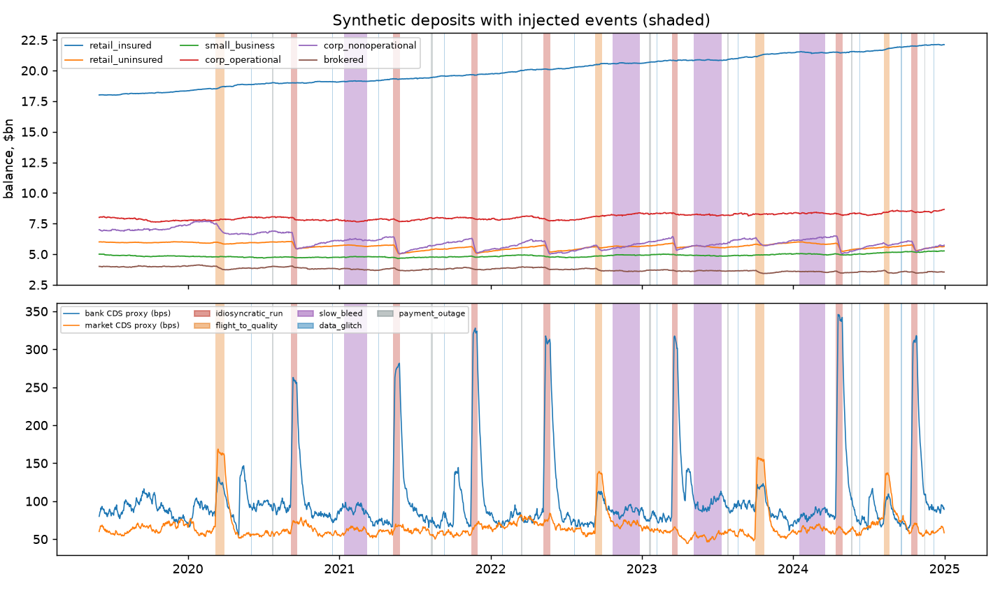
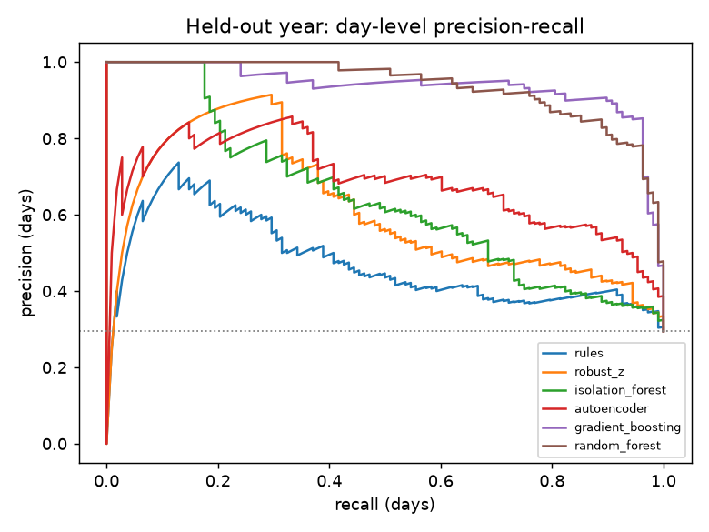
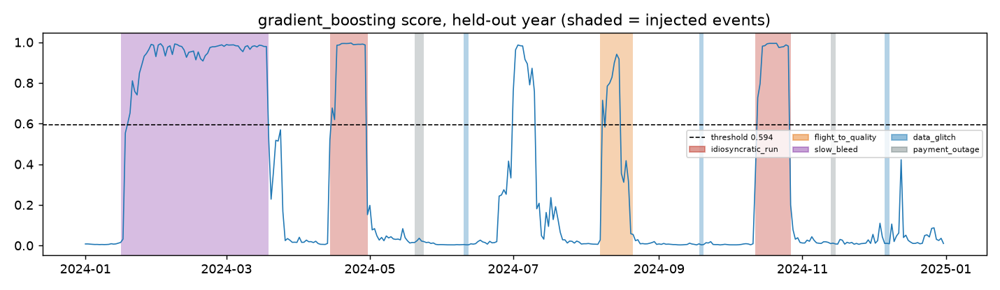
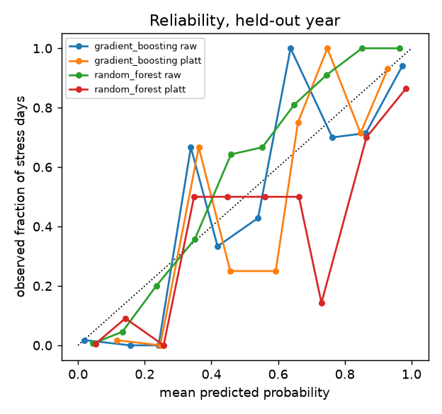
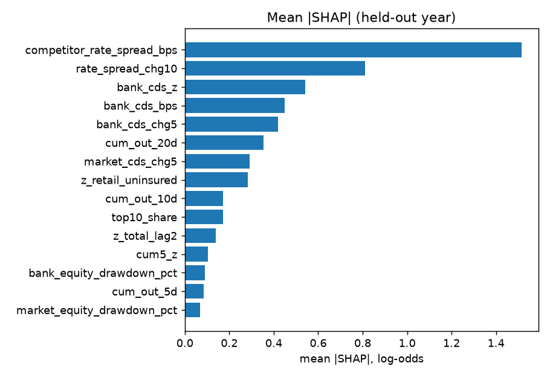
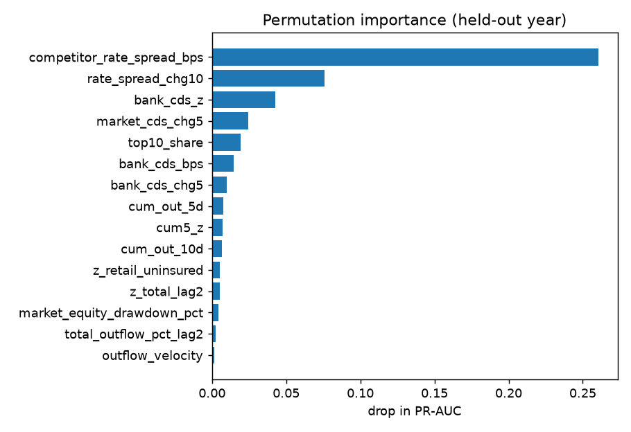
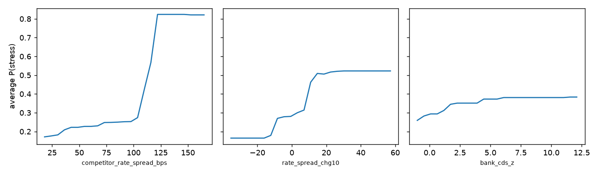
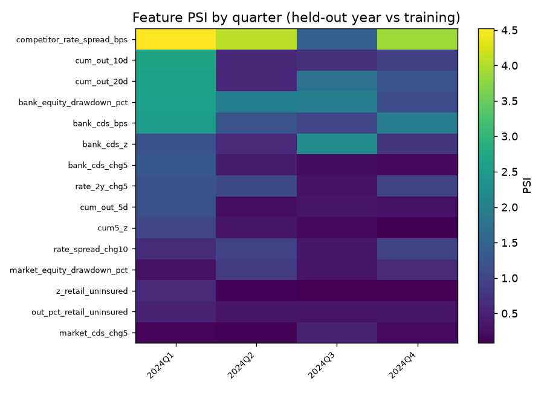

# deposit-anomaly-detector

A machine-learning detector for abnormal deposit outflows and liquidity-stress signals, built on a seeded synthetic bank deposit dataset. It compares a transparent rules baseline and a robust statistical baseline with Isolation Forest, an autoencoder, gradient boosting and a random forest, using expanding-window time-series validation with a purge gap and a held-out final year. It reports event-level and day-level metrics, cost-sensitive thresholds, calibration, interval estimates, interpretability (permutation importance, SHAP, partial dependence, per-alert explanations), model-risk stability checks (PSI) and a daily scoring script with severity tiers.

**All data is synthetic. Every parameter is invented (stylized). Results show how the method behaves on a controlled generator, not how it would perform on a real bank.**



## Install and run

```
pip install -e .
python -m unittest discover -s tests -v
python examples/01_generate_and_validate_data.py
python examples/02_model_comparison.py
python examples/03_interpretability_and_risk.py
python examples/04_daily_monitoring.py
python examples/05_seed_robustness.py
python examples/06_feature_ablation.py
```

Requires Python 3.11+, numpy, pandas, scikit-learn, scipy, matplotlib and shap (all installed by `pip install -e .`). Examples write CSV, Markdown and PNG files to `examples/output/`. Each experiment script retrains everything (about 15 seconds; example 05 repeats it for 8 seeds).

## Layout

```
src/deposit_anomaly/
  columns.py      column and label name constants
  calendar.py     business days, payroll, month-end, tax days, holidays
  generator.py    seeded synthetic deposits, events and labels (independent of the detector)
  features.py     feature engineering (no look-ahead)
  splits.py       expanding-window folds with purge gap, held-out split
  models.py       rules, robust z, Isolation Forest, autoencoder, gradient boosting, random forest
  dq.py           data-quality router
  evaluation.py   event and day metrics, cost-based thresholds, calibration, intervals
  pipeline.py     end-to-end experiment
  interpret.py    permutation importance, SHAP, explanations, partial dependence
  risk.py         PSI and score drift
  monitoring.py   daily alert log with severity tiers, drift report
  plotting.py     PNG charts
tests/            132 unittest tests
docs/             methodology.md, model_card.md
examples/         runnable scripts and their outputs in examples/output/
```

## Data and labels

Daily, 2019-06-01 to 2024-12-31 (2,041 days; the first 214 are feature warm-up, so the modelling window is 2020-01-01 to 2024-12-31, 1,827 days). Six segments (retail insured, retail uninsured, small business, corporate operational, corporate non-operational, brokered) with seasonality (payroll, month-end, tax dates, holidays, weekends), trend, heavy-tailed noise, and market indicators (bank and market CDS-like spreads, equity drawdowns, a 2-year rate, a competitor rate spread). 33 labelled events are injected:

| Event type | Events | Days labelled | Real outflow? |
|---|---|---|---|
| idiosyncratic run on uninsured corporate deposits | 7 | 109 | yes |
| market-wide flight to quality | 4 | 75 | yes |
| slow bleed from rate competition | 4 | 251 | yes |
| data glitch (spurious record, reversed next day) | 11 | 22 | no |
| payment-system outage (flows delayed, then posted) | 7 | 24 | no |
| none | | 1,560 | |

Eight unlabelled benign market bumps (competitor-spread and CDS moves with no outflow) are added so market indicators are not a perfect tell. Label rules, magnitudes and windows are in [docs/methodology.md](docs/methodology.md). Dataset checks from `examples/output/data_checks.md`: minimum balance 3,421.6 USD m (never negative); the ledger reconciles to reported flows to 0.0000% on all non-glitch days and breaks by up to 0.7457% of balances on glitch days; 21.3% of days are labelled liquidity stress.

## Method in brief

- **Features (42):** outflow percent of balance (total and per segment), seasonality-adjusted robust z-scores, lagged flows, 5/10/20-day cumulative outflow, breadth across segments, velocity and acceleration, a top-10-account concentration proxy, reconciliation gap and payment queue indicators, and market signals. Feature values at day t use data through day t only (tested by perturbing and truncating the future).
- **Validation:** five expanding-window folds (validation blocks 2021-H2 to 2023-H2) with a 90-day purge gap equal to the longest rolling window, then a final held-out 2024 never used for fitting or threshold choice.
- **Alerting:** thresholds chosen on out-of-fold scores to minimise `100 x missed liquidity events + 1 x false-alarm weeks` (assumed costs). A liquidity event counts as detected if any alert falls in its window; lead time is measured to the day cumulative injected outflow reaches 50%.
- **Data quality:** a router suppresses liquidity alerts on days where the reconciliation gap or payment-queue backlog is abnormal.

## Results

Held-out year 2024: 4 liquidity events (2 runs, 1 flight to quality, 1 slow bleed) and 5 data-quality events (3 glitches, 2 outages). All numbers below were produced by the example scripts.

### Cross-validation (out-of-fold, 2021-07-01 to 2023-12-31, 7 liquidity events and 9 data-quality events)

Day-level PR-AUC by fold (`cv_pr_auc_by_fold.md`):

| model | fold 1 | fold 2 | fold 3 | fold 4 | fold 5 |
|---|---|---|---|---|---|
| rules | 0.369 | 0.352 | 0.530 | 0.455 | 0.294 |
| robust_z | 0.754 | 0.606 | 0.573 | 0.543 | 0.360 |
| isolation_forest | 0.831 | 0.839 | 0.672 | 0.547 | 0.457 |
| autoencoder | 0.853 | 0.915 | 0.684 | 0.590 | 0.576 |
| gradient_boosting | 0.844 | 1.000 | 0.924 | 0.846 | 0.926 |
| random_forest | 0.908 | 0.997 | 0.956 | 0.935 | 0.940 |

Out-of-fold comparison (`model_comparison_oof.md`). Thresholds were selected on these same scores, so detection and false-alarm figures are in-sample for the threshold and optimistic:

| model | threshold | PR-AUC | precision | recall | detected | mean lead (days) | false-alarm weeks / year |
|---|---|---|---|---|---|---|---|
| rules | 0.805 | 0.343 | 0.471 | 0.110 | 7/7 | 4.000 | 9.591 |
| robust_z | 5.029 | 0.439 | 0.590 | 0.211 | 7/7 | 2.857 | 9.990 |
| isolation_forest | 0.455 | 0.521 | 0.652 | 0.266 | 7/7 | 10.000 | 6.394 |
| autoencoder | 1.704 | 0.574 | 0.682 | 0.275 | 7/7 | 11.000 | 5.994 |
| gradient_boosting | 0.594 | 0.746 | 0.784 | 0.399 | 7/7 | 8.571 | 3.597 |
| random_forest | 0.617 | 0.846 | 0.973 | 0.335 | 7/7 | 6.714 | 0.000 |
| rules_fixed_policy | 1.000 | 0.343 | 0.375 | 0.041 | 5/7 | 2.800 | 5.595 |

### Held-out year (thresholds frozen from out-of-fold scores)

Model comparison (`model_comparison_holdout.md` and `model_comparison_holdout_routed.md`). "DQ alerted" is how many of the 5 glitch and outage events raised a liquidity alert (raw, before routing). "FA/yr routed" is false-alarm weeks per year after data-quality routing.

| model | PR-AUC | precision | recall | detected | mean lead (days) | FA/yr raw | FA/yr routed | DQ alerted |
|---|---|---|---|---|---|---|---|---|
| rules | 0.475 | 0.690 | 0.185 | 4/4 | 3.750 | 7.984 | 4.990 | 3/5 |
| robust_z | 0.604 | 0.810 | 0.315 | 4/4 | 8.500 | 7.984 | 4.990 | 3/5 |
| isolation_forest | 0.643 | 0.756 | 0.315 | 4/4 | 10.000 | 3.992 | 0.998 | 3/5 |
| autoencoder | 0.685 | 0.800 | 0.370 | 4/4 | 10.250 | 4.990 | 0.000 | 5/5 |
| gradient_boosting | 0.937 | 0.906 | 0.889 | 4/4 | 13.250 | 1.996 | 1.996 | 0/5 |
| random_forest | 0.937 | 0.933 | 0.648 | 4/4 | 9.250 | 1.996 | 1.996 | 0/5 |
| rules_fixed_policy | 0.475 | 0.643 | 0.083 | 3/4 | 3.000 | 4.990 | 1.996 | 3/5 |

Precision and recall are day-level at the chosen threshold. Detection by event type, held-out year (alerted events with mean lead days in brackets; `by_event_type_holdout.md`):

| model | runs (2) | flight to quality (1) | slow bleed (1) | glitches alerted (3) | outages alerted (2) |
|---|---|---|---|---|---|
| rules | 2 (4.00) | 1 (1.00) | 1 (6.00) | 3 | 0 |
| robust_z | 2 (5.00) | 1 (1.00) | 1 (23.00) | 3 | 0 |
| isolation_forest | 2 (5.00) | 1 (7.00) | 1 (23.00) | 3 | 0 |
| autoencoder | 2 (6.50) | 1 (6.00) | 1 (22.00) | 3 | 2 |
| gradient_boosting | 2 (7.00) | 1 (6.00) | 1 (33.00) | 0 | 0 |
| random_forest | 2 (5.00) | 1 (1.00) | 1 (26.00) | 0 | 0 |
| rules_fixed_policy | 2 (1.50) | 0 | 1 (6.00) | 3 | 0 |

The data glitch is separable: both supervised models never raise a liquidity alert on any of the 3 held-out glitches, while the baselines, Isolation Forest and the autoencoder do, and the data-quality router (limits fitted without labels) flags all 22 glitch days and all 24 outage days with no flag on any of the 1,346 event-free days. That is the easy case: the synthetic reconciliation gap and queue are clean. The slow bleed lead times are long partly because the competitor spread is a deliberate precursor in the generator.

Intervals (`holdout_intervals.md`): PR-AUC by block bootstrap, detection by exact binomial, false alarms by exact Poisson. With 4 events these detection intervals are very wide.

| model | PR-AUC [95%] | detection rate [95%] | FA weeks/yr [95%] |
|---|---|---|---|
| rules | 0.475 [0.282, 0.666] | 1.000 [0.398, 1.000] | 7.984 [3.447, 15.731] |
| robust_z | 0.604 [0.396, 0.773] | 1.000 [0.398, 1.000] | 7.984 [3.447, 15.731] |
| isolation_forest | 0.643 [0.410, 0.809] | 1.000 [0.398, 1.000] | 3.992 [1.088, 10.221] |
| autoencoder | 0.685 [0.464, 0.856] | 1.000 [0.398, 1.000] | 4.990 [1.620, 11.644] |
| gradient_boosting | 0.937 [0.826, 0.995] | 1.000 [0.398, 1.000] | 1.996 [0.242, 7.210] |
| random_forest | 0.937 [0.851, 0.988] | 1.000 [0.398, 1.000] | 1.996 [0.242, 7.210] |
| rules_fixed_policy | 0.475 [0.282, 0.666] | 0.750 [0.194, 0.994] | 4.990 [1.620, 11.644] |





In the score chart the large spike in July 2024 with no shaded event is a false alarm: it coincides with two overlapping unlabelled nuisance windows (a competitor-spread bump from 2024-06-24 and a bank-CDS bump from 2024-07-01).

### Robustness across generator seeds (`seed_robustness.md`)

The full experiment repeated on 8 other generator seeds (101 to 108; same event schedule, different noise and magnitudes), held-out year, thresholds re-selected each time. Mean (standard deviation):

| model | PR-AUC | detection rate | mean lead (days) | FA weeks/yr |
|---|---|---|---|---|
| rules | 0.454 (0.044) | 0.875 (0.134) | 7.781 (4.611) | 10.478 (3.064) |
| robust_z | 0.577 (0.036) | 0.969 (0.088) | 9.198 (3.246) | 7.734 (2.371) |
| isolation_forest | 0.598 (0.032) | 1.000 (0.000) | 8.875 (2.248) | 6.611 (2.498) |
| autoencoder | 0.676 (0.049) | 0.969 (0.088) | 7.573 (4.917) | 6.237 (1.578) |
| gradient_boosting | 0.921 (0.043) | 0.906 (0.129) | 10.792 (1.350) | 1.996 (1.067) |
| random_forest | 0.960 (0.022) | 1.000 (0.000) | 10.406 (1.706) | 1.123 (1.639) |
| rules_fixed_policy | 0.454 (0.044) | 0.594 (0.229) | 4.792 (6.761) | 6.112 (2.096) |

On PR-AUC the two supervised models rank first and the rules baseline last on average across seeds. The gradient-boosting detection rate falls below 1 on some seeds, so the 4/4 on the default seed should not be read as a guarantee.

### Calibration (`calibration.md`)

Held-out year, 10 equal-width bins. Raw scores exist only for the probabilistic classifiers.

| model | Brier (Platt) | ECE (Platt) | Brier (raw) | ECE (raw) |
|---|---|---|---|---|
| gradient_boosting | 0.0559 | 0.0905 | 0.0496 | 0.0338 |
| random_forest | 0.0752 | 0.0902 | 0.0689 | 0.0769 |
| isolation_forest | 0.1682 | 0.0629 | | |
| autoencoder | 0.1666 | 0.1227 | | |
| robust_z | 0.1773 | 0.1185 | | |
| rules | 0.2026 | 0.1312 | | |

Platt scaling fitted on out-of-fold scores made gradient boosting slightly worse on the held-out year (raw scores are already close to calibrated); it is reported rather than hidden. The unsupervised scores need a calibration layer to be read as probabilities and remain poorly calibrated even with it.



### What drives the gradient-boosting model (`feature_ablation.md`)

Retraining with feature groups removed (held-out year, thresholds re-selected):

| features | PR-AUC | detection | mean lead (days) | FA weeks/yr | DQ events alerted |
|---|---|---|---|---|---|
| all 42 | 0.937 | 4/4 | 13.250 | 1.996 | 0/5 |
| without top-10 share, reconciliation gap, queue | 0.936 | 4/4 | 13.750 | 2.994 | 0/5 |
| without market and rate-spread signals | 0.844 | 4/4 | 9.000 | 1.996 | 0/5 |
| flows only | 0.830 | 4/4 | 8.750 | 1.996 | 0/5 |

Removing the operational and concentration signals does not change glitch handling here: the single-segment spike in the flow features is enough for the classifier to learn that glitches are not stress.

## Interpretability

Held-out year, gradient boosting. Permutation importance (drop in PR-AUC; `permutation_importance.md`): competitor rate spread 0.2604, 10-day change in the spread 0.0756, bank CDS robust z 0.0427, market CDS 5-day change 0.0245, top-10 share 0.0193. Mean absolute SHAP (log-odds; `shap_importance.md`) ranks the same first two features on top: 1.5142 and 0.8108, then bank CDS z 0.5420, bank CDS level 0.4496, bank CDS 5-day change 0.4184. The dominance of the spread reflects the long slow-bleed windows (251 of the 435 stress days) and the generator tying the spread to that event type.

SHAP uses `shap.TreeExplainer` (installed and working). Per-alert explanations list the top three contributors for each flagged day, for example 2024-01-19 (slow bleed): `rate_spread_chg10=23.10 (+2.69); bank_cds_bps=77.80 (-1.24); competitor_rate_spread_bps=56.62 (-0.53)` (`alert_explanations.md`). Partial dependence for the top three drivers is in `partial_dependence.png`.







## Model risk: stability across time

- Fold-to-fold PR-AUC for gradient boosting ranges from 0.844 to 1.000 (`cv_stability.md`); for Isolation Forest from 0.457 to 0.839 and the autoencoder from 0.576 to 0.915, so the unsupervised detectors degrade in later folds.
- Feature PSI, training window vs held-out year (`feature_psi.md`): largest are `rate_2y_chg5` 0.315, `bank_cds_z` 0.240, `competitor_rate_spread_bps` 0.136, `bank_equity_drawdown_pct` 0.135. On event-free days only, `rate_2y_chg5` is 0.337, `bank_cds_z` 0.344, `bank_equity_drawdown_pct` 0.382, so some drift is structural (the simulated rate and equity paths), not just stress days.
- Model-score PSI by quarter against out-of-fold scores (`score_drift.md`): 2024Q1 1.897, Q2 0.197, Q3 0.313, Q4 0.650. Quarters with injected stress events move the score distribution by construction.



## Monitoring

`python examples/04_daily_monitoring.py` scores the held-out year day by day with the gradient-boosting model and writes `alert_log.csv` (one row per day: score, calibrated probability, severity, route, data-quality reason, consecutive alert days, explanation), an excerpt, and a drift report. Tiers: WATCH (score at least half the threshold), ALERT, CRITICAL (probability at least 0.90 or 3 consecutive alert days), DATA_QUALITY (router fired). Days by severity against the truth labels (`alert_severity_by_truth.md`):

| true event type | none | WATCH | ALERT | CRITICAL | DATA_QUALITY |
|---|---|---|---|---|---|
| none | 228 | 8 | 1 | 9 | 0 |
| idiosyncratic_run | 0 | 2 | 4 | 25 | 0 |
| flight_to_quality | 2 | 5 | 3 | 4 | 0 |
| slow_bleed | 2 | 1 | 2 | 58 | 0 |
| data_glitch | 0 | 0 | 0 | 0 | 6 |
| payment_outage | 0 | 0 | 0 | 0 | 6 |

The drift report (`drift_report.md`, last 90 days of 2024 vs the training window) lists features at ACTION status because that window contains the October run; the score PSI row is 0.651.

## Limitations

- **Synthetic and co-designed.** The generator and detector were written together; injected signals (competitor spread, CDS, concentration, reconciliation gap) are cleaner than real ones. Supervised models are rewarded for learning them, so their lead over the baselines is an upper bound.
- **Very few events.** The held-out year has 4 liquidity events and 5 data-quality events; per-type results rest on 1 or 2 events, and the intervals above are wide. Out-of-fold thresholds are tuned on the same 7 liquidity events they are evaluated on.
- **Thresholds depend on assumed costs** (100 per missed event, 1 per false-alarm week). These are stylized, not estimated.
- **Slow-bleed windows dominate the positive class** (251 of 435 labelled liquidity days), which drives day-level PR-AUC and the importance rankings.
- **Seasonality model uses all past rows**, including stress periods, so event-free z-scores are not exactly centred (mean total z -0.33, sd 1.44). Its memory is the one feature input longer than the 90-day purge gap, though always backward-looking.
- **Unsupervised detectors cannot tell a data error or outage from stress** without the routing layer; the routing works here because the synthetic indicators are clean.
- **Real deposit flows** have regime changes, correlated customer behaviour, intraday dynamics, payment-system structure and balance-sheet context that are not modelled.
- **Scores are not probabilities** for the unsupervised models; calibration for gradient boosting was not improved by Platt scaling.
- **Randomness:** the random forest uses multithreading, so scores can differ at the 1e-16 level between runs; metrics did not change at the printed precision.
- **Not for production** use without independent validation. See [docs/model_card.md](docs/model_card.md).

## Stylized and unverified

All data and every generator parameter (balances, noise, event magnitudes, durations, market-spread responses) are invented. The cost ratio is assumed. The PSI bands (0.10, 0.25) are a common convention, not a regulatory requirement. No regulatory parameter is used or asserted.
